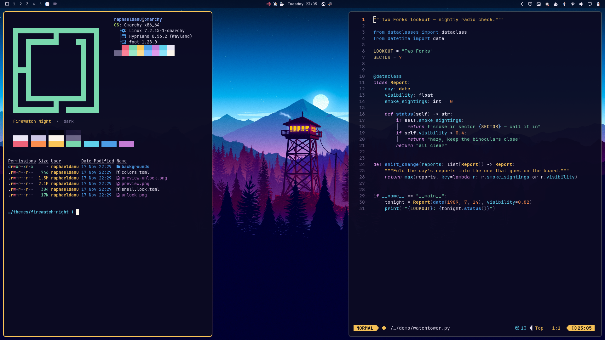
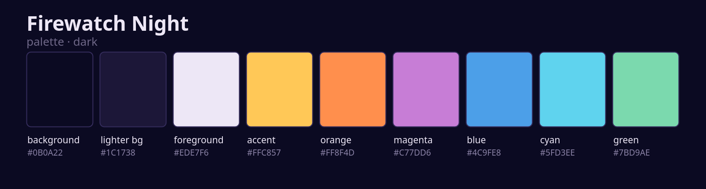

<p align="center">
  
</p>

<h1 align="center">Firewatch Night</h1>

<p align="center">
  An <a href="https://omarchy.org">Omarchy</a> theme pulled from the night sky over the Two Forks lookout:
  deep indigo, violet ridges, a lit amber cabin and cold sky blue.
</p>

---

## Install

```bash
omarchy theme install https://github.com/raphaeldanu/omarchy-firewatch-theme.git
```

Omarchy names an installed theme after the repository, so this one arrives as
**Firewatch**. If you would rather see the full name in `omarchy theme list`:

```bash
mv ~/.config/omarchy/themes/firewatch ~/.config/omarchy/themes/firewatch-night
omarchy theme set firewatch-night
```

### Manual install

```bash
git clone https://github.com/raphaeldanu/omarchy-firewatch-theme.git \
  ~/.config/omarchy/themes/firewatch-night
omarchy theme set firewatch-night
```

Applying the theme re-renders every config Omarchy themes for you — Alacritty,
foot, Kitty, Ghostty, btop, tmux, Neovim, Helix, VS Code, Chromium/Chrome/Brave,
GTK/GNOME appearance, Obsidian, fcitx5, the shell and bar — from
[`colors.toml`](colors.toml). Nothing else to copy by hand.

## Palette

<p align="center">
  
</p>

| Role | Hex | Role | Hex |
| --- | --- | --- | --- |
| Background | `#0B0A22` | Red | `#F2637A` |
| Darker background | `#04030C` | Orange | `#FF8F4D` |
| Lighter background | `#1C1738` | Yellow / accent | `#FFC857` |
| Foreground | `#EDE7F6` | Green | `#7BD9AE` |
| Muted | `#6E6787` | Cyan | `#5FD3EE` |
| Selection | `#3B2D63` | Blue | `#4C9FE8` |
| Bright foreground | `#FFF8EC` | Magenta | `#C77DD6` |

## What is in here

| File | Purpose |
| --- | --- |
| `colors.toml` | The palette every themed app is generated from |
| `shell.lock.toml` | Lock-screen field colors for the built-in `omarchy.lock` |
| `backgrounds/1-firewatch-night.webp` | The wallpaper |
| `preview.png` | Screenshot shown in the theme switcher |
| `unlock.png` | Tower mark used by the boot and login screen |
| `preview-unlock.png` | Preview of that boot screen |
| `palette.png` | Palette reference used in this README |

Themes installed from a repository are only allowed to ship palette, background,
preview and boot assets — no `*.lua`, terminal configs or `vscode.json`. This
theme ships none of those; all app configs are generated by Omarchy.

## Optional extras

### Boot and login screen

`unlock.png` is the lookout tower in the theme's amber. To use it on the Plymouth
boot screen and the SDDM login screen:

```bash
omarchy plymouth set by theme firewatch-night   # or `firewatch` if you kept the repo name
```

This rebuilds the unified kernel image, so the next boot picks it up. Undo with:

```bash
omarchy plymouth reset
```

### Screensaver

Omarchy's screensaver branding is global rather than per-theme. The ASCII art in
[`extras/screensaver.txt`](extras/screensaver.txt) is the lookout tower and
`FIREWATCH` wordmark, transcoded from the wallpaper:

```bash
mkdir -p ~/.config/omarchy/branding
cp extras/screensaver.txt ~/.config/omarchy/branding/screensaver.txt
omarchy-launch-screensaver   # preview it
```

Reset to the stock art with:

```bash
omarchy branding screensaver reset
```

### Lock screen

The palette in `shell.lock.toml` is used by the built-in `omarchy.lock` plugin.
The third-party *Lock Screen Explorer* plugin reads the theme colors as well, so
no extra work is needed there — its video or design is a separate choice.

## Uninstall

```bash
omarchy theme set tokyo-night
omarchy theme remove firewatch-night   # or `firewatch` if you kept the repo name
```

`omarchy plymouth reset` restores the stock boot screen if you changed it, and
`omarchy branding screensaver reset` restores the stock screensaver art.

## Credits

- Wallpaper is *Firewatch* key art by Campo Santo. It is bundled here so the
  theme is self-contained; it is **not** covered by the MIT license below and
  remains the property of its authors. Use it for personal desktop theming only.
- The screensaver art was generated from that wallpaper with
  `omarchy transcode ascii`.

## License

The theme files (`colors.toml`, `shell.lock.toml`, previews and screensaver art)
are released under the [MIT license](LICENSE), excluding the wallpaper and the
*Firewatch* name and artwork.
